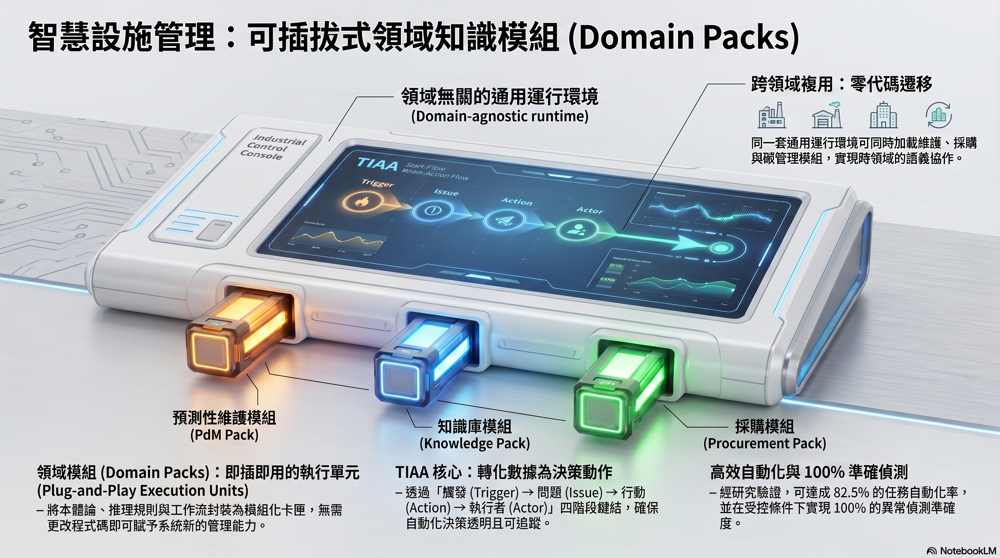

於 2026 SEMICON Taiwan 台灣高科技廠房設施協會（HTFA）R&D 專區發表學術海報。

本研究針對高科技廠務運維的語意－執行落差（Semantic-Execution Gap），提出以可插拔領域知識模組（Domain Pack）為核心的語意決策框架。如同遊戲機換卡帶，同一套執行環境無需重新開發，即可載入不同廠務業務的管理邏輯。

## 核心框架

研究以 **TIAA**（Trigger–Issue–Action–Actor–Propagation）作為最小可執行語意單元，每一個感測異常事件都被解析為完整的決策鏈：偵測觸發條件、語意解讀議題、自動執行行動、指派責任執行者，並在完成後向鄰近知識域傳播更新，維持全廠語意狀態一致。

## 廠務案例

以**空調箱冷凍機效率異常**（HVAC PdM Pack）與**超純水系統壓差異常**（UPW Monitoring Pack）為例，展示框架在不同廠務場域的完整執行過程。

完整案例說明請掃海報 QR Code，或直接訪問：[廠務案例補充說明頁面](https://built-insight.org/2026htfa-case/index-biz.html)

## 驗證結果

| 指標 | 數值 |
|------|------|
| 任務自動化率 | 82.5% |
| 異常偵測精確率 | 92% |
| 來源重建成功率 | >99% |
| 知識圖譜查詢回應 | 0.75s |

驗證數據來自發表於 Advanced Engineering Informatics（AEI）之正式論文（[DOI: 10.1016/j.aei.2025.104240](https://doi.org/10.1016/j.aei.2025.104240)）。

## 產學合作邀請

目前驗證場域為模擬情境，誠摯邀請高科技廠房業者共同推動真實場域驗證。歡迎有意深入了解的廠務業主與設施工程師直接聯絡，討論導入可行性。
